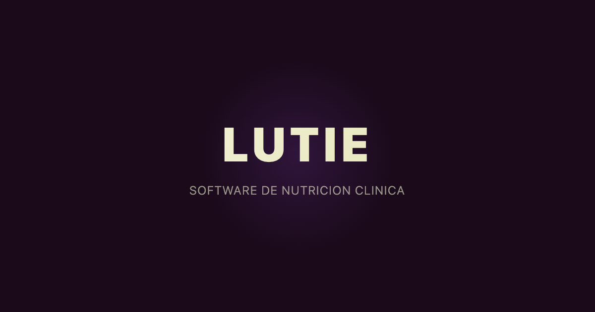
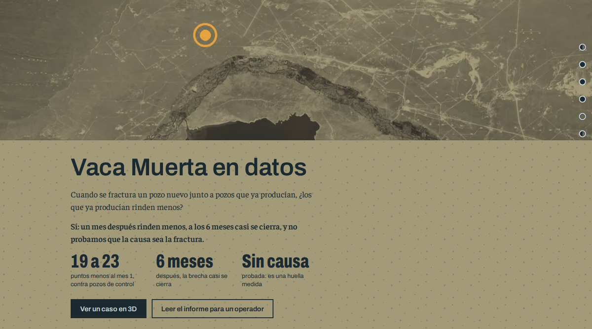
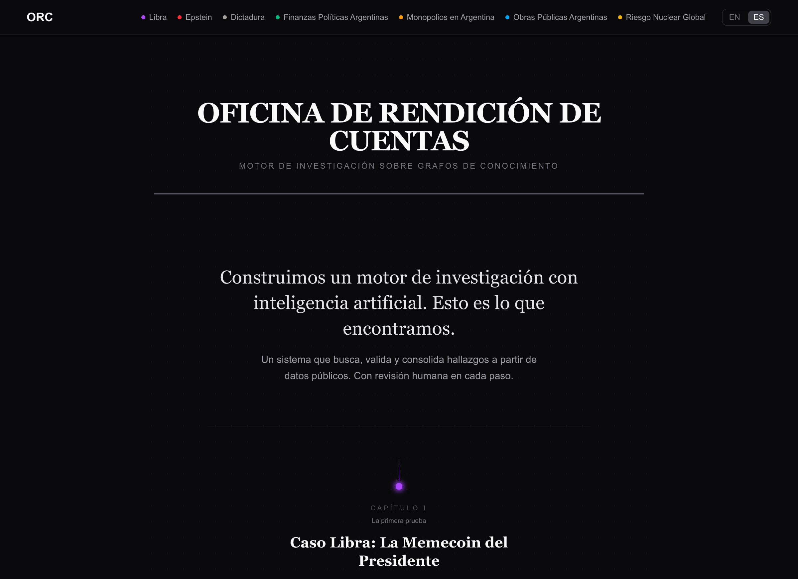

### Gabriel Ruiz Varela

Building tools for **nutrition**, **civic transparency** and **public energy data**.

---

#### Lutie &nbsp;`commercial` `closed-source`

Evidence-based **nutrition planning**: Spanish-first, mobile-first, offline-capable PWA.

**AI & MCP:** AI-powered meal planning assistant with MCP tool integration. Caloric phase tracking (cutting/bulking/maintaining), macro optimization, and personalized meal plan generation via GRASP constraint-optimization solver.

**Features:** Food composition database, daily macro tracking, caloric phase management with deficit/surplus calculations, AI-driven recipe substitution, and freemium billing with subscription gating.

**Infrastructure:** Offline-first with IndexedDB + background sync. Push notifications. Clean Architecture + DDD.

`Next.js` `Supabase` `Gemini` `MCP` `Zustand` `Tailwind`

**[lutie.app →](https://lutie.app)**

---

#### Vaca Muerta en datos &nbsp;`data engineering` `public data` `open-source`

Independent study of Argentina's **Vaca Muerta** shale, built only on the energy secretariat's **monthly public data**: when a new well is fractured, what happens to the producing wells next to it?

**Pipeline:** Hash-versioned ingestion, a DuckDB warehouse from typed staging tables to well, well-month and event facts, table lineage, and blocking quality checks that stop a build before anything is published.

**Method:** Event study over 2,094 fracture events against control wells 2 to 5 km away, placebo dates and permutations, decision rules written down before each run committed first (later additions marked), and the same test rerun in two US basins. Every figure in the text is checked against the warehouse; 1,200+ automated tests.

**How it was built:** Solo, by directing AI coding agents: I planned, reviewed and merged the work in 146 pull requests.

**Read it:** Front page and operator report in Spanish, a month-by-month 3D replay of the basin in WebGL, and a natural-language question agent with typed read-only tools, served over MCP.

`Python` `DuckDB` `SQL` `MCP` `WebGL` `Cloudflare`

**[vaca-muerta-en-datos →](https://vaca-muerta-en-datos.gabrielruizvarela.workers.dev)** &nbsp; **[code →](https://github.com/GabrielRuizVarela/vaca-muerta-en-datos)**

---

#### Office of Accountability &nbsp;`open-source`

Civic knowledge platform that transforms **fragmented public records** into navigable **knowledge graphs**. Cross-references entities across datasets to reveal connections between persons, organizations, documents, and financial flows.

| | Investigation | Scale |
|:---:|---|---|
| I | **Caso Libra:** $LIBRA memecoin | $251M+ losses · 114K wallets |
| II | **Caso Epstein:** trafficking network | 7,276 entities · 374 actors |
| III | **Finanzas Políticas Argentinas** | 329 legislators · 7 sources |
| IV | **Obras Públicas & Caso Adorni** | 87,725 contracts · 18 sectors |
| V | **Caso Dictadura 1976 to 1983** | 9,415 victims · 774 centers |
| VI | **Global Nuclear Risk** | 31 sources · 9 states · *in dev* |

`TypeScript` `Neo4j` `Knowledge Graphs` `NLP`

**[office-of-accountability.org →](https://office-of-accountability.org/)** · **[GitHub →](https://github.com/GabrielRuizVarela/office-of-accountability)**

---

#### Engineering Research

- [Biomechanical sound source polar pattern measurement](https://drive.google.com/file/d/1rOASwHCp-RMIGml1D_QBY2APR5RGlX6Q/view?usp=sharing)
- [Isotropy evolution in a decaying sound field inside a reverberant room](https://drive.google.com/file/d/12xD_orI_FXxF6glyaHA1aQex5ILdyOxO/view?usp=sharing)
